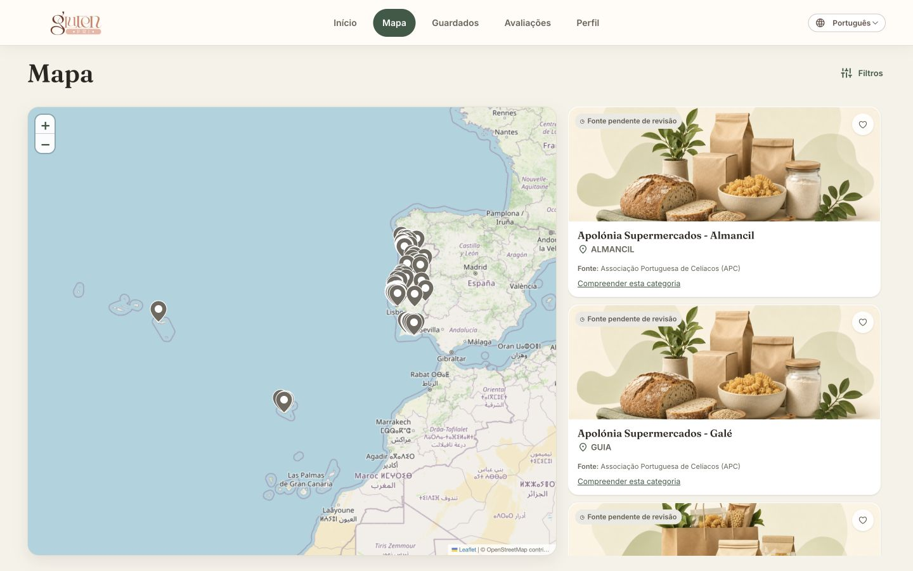

# Cobertura nacional y referencias públicas de APC

Consulta realizada el 24/11/2026. Trabajo local, pendiente de importación en producción.

## Cambios visibles

- Cabecera: «Portugal».
- Footer en pt-PT, es y en: cobertura nacional.
- Metadatos de ficha, manifest y README sin la limitación al norte.
- Centro inicial nacional y mapa ajustado a los establecimientos con coordenadas, incluidas Madeira y Açores.
- Carga de todas las páginas del directorio; ya no se limita silenciosamente a los primeros 100 registros. Si una página falla, se comunica el error en vez de presentar un catálogo parcial como completo.
- Coordenadas nulas no se convierten en marcadores en `(0, 0)`.
- Las localidades extraídas no muestran números de puerta como si fueran ciudades.

## Fuentes consultadas

1. [Índice nacional de puntos de venta y establecimientos de APC](https://www.celiacos.org.pt/pontos-de-venda-e-estabelecimentos-certificados-apc-biotrab/).
2. [Sección online de APC](https://www.celiacos.org.pt/pontos-de-venda-e-estabelecimentos-certificados-apc-biotrab-online/).

La captura local está en `server/data/apc-portugal.json`. Incluye únicamente campos públicos necesarios: nombre, ubicación publicada, teléfono cuando tiene formato utilizable, enlace publicado, enlace de procedencia, región y fecha de consulta. No se copiaron logos, fotografías oficiales ni emails de contacto. Se retiraron etiquetas HTML de los nombres.

| Región de la fuente | Referencias |
| --- | ---: |
| Algarve | 10 |
| Setúbal | 2 |
| Alentejo | 7 |
| Lisboa | 80 |
| Centro | 30 |
| Norte | 43 |
| Madeira | 10 |
| Açores | 4 |
| Online | 19 |
| Total | 205 |

Son referencias de la lista, no necesariamente 205 negocios únicos. La selección abarca las ocho regiones presentes en el índice nacional y la sección online; no se afirma que incluya todos los negocios portugueses ni que todas las fichas sigan vigentes.

De las 186 referencias físicas, 182 traían coordenadas. Se apartó una coordenada de Celeiro - Aveiro que apunta fuera de Portugal: se conserva su valor original en `provenance.sourceCoordinates` para revisión, sin inventar un reemplazo. Quedan 181 referencias con coordenadas disponibles para el mapa. Las 19 tiendas online no reciben coordenadas físicas inventadas.

## Clasificación y procedencia

La aparición en el directorio de APC no equivale automáticamente a certificación. Las altas se preparan como `sourceType: public_source`, `informationCategory: point_of_sale`, `confidenceLevel: source_pending_review` y revisión pendiente. No se activa certificación externa ni se inventan fechas de verificación, vigencias o autorizaciones.

El tipo de negocio se asigna de forma preliminar a partir del icono de la lista o del nombre, y esa inferencia queda señalada en `provenance.typeAssignment`. Requiere revisión editorial en los casos ambiguos. Las notas promocionales originales se conservan como contexto de procedencia, pero no se publican automáticamente como descuento vigente o general para cualquier usuario.

La fecha de consulta se conserva en el snapshot y en `informationSources` al preparar cada documento. No se usa como `lastVerifiedAt`. Los enlaces oficiales se mantienen como fuente neutral; GlutenFri sigue siendo independiente de APC/Biotrab.

## Importación conservadora

`npm run apc:plan` en `server/` compara por defecto contra el archivo local heredado, sin cargar credenciales ni abrir una conexión MongoDB.

Resultado observado: **168 altas propuestas, 2 coincidencias exactas y 35 casos pendientes de revisión**. Estas cifras no describen Atlas, cuyo estado actual no se ha consultado.

El script `src/scripts/importApcPortugal.js` permite aplicar una importación únicamente con `--apply --database=NOMBRE_EXACTO`. En ese modo verifica el nombre conectado, desactiva creación automática de colecciones/índices y recalcula el plan contra el destino. Usa `$setOnInsert`: no actualiza ni borra registros existentes. Los candidatos ambiguos por nombre, teléfono compartido o coordenadas cercanas quedan apartados. El script no programa sincronizaciones ni campañas.

**No se ejecutó `--apply`.** El acceso de la organización Atlas para clientes de IA sigue bloqueado. La importación real requiere recuperar ese acceso y la conectividad del clúster, confirmar el destino y revisar los candidatos ambiguos. No se utilizó el seed destructivo existente ni se sustituyeron establecimientos reales por el snapshot.

## Comprobación visual

El modo `QA_DIRECTORY=apc` del servicio local existente permite revisar estas referencias sin escribir en MongoDB. Los IDs `apc-reference-*` son identificadores exclusivos del preview, no ObjectIds reales de producción.

Se comprobó en navegador real: carga de las tres páginas hasta 205 referencias, búsqueda «Lisboa» con 33 resultados y fuente APC legible; listado sin scroll horizontal de página en 375 × 812, 430 × 932, 768 × 1024 y 1440 × 900. El mapa muestra 181 marcadores y ajusta su vista a Portugal continental y las islas tras apartar el dato erróneo.

Estas capturas corresponden a la previsualización local, no a la aplicación publicada. La inserción de registros, la ausencia de duplicados en Atlas y la navegación autenticada de producción no están validadas.

## Validaciones y archivos

- Cliente: 85 pruebas correctas; lint con exit 0 y las advertencias existentes de hooks/pureza; i18n sin fallos; build correcto.
- Servidor: 49 pruebas correctas, 1 integración omitida por requerir Mongo local.
- `npm run apc:plan`: correcto, sin conexión ni escrituras en base de datos.
- `git diff --check`: correcto.
- Pruebas añadidas de paginación, fallo de página, carga de página explícita, procedencia nacional y deduplicación conservadora; regresiones de coordenadas nulas y localidades numéricas.

Archivos de esta ampliación: `client/src/config/brand.js`, `client/src/i18n/index.jsx`, `client/src/components/EstablishmentSeo.jsx`, `client/public/manifest.webmanifest`, `client/src/hooks/useUserLocation.js`, `client/src/components/MapView.jsx`, `client/src/services/establishmentsLoader.js`, `client/src/utils/establishmentData.js`, `client/src/utils/trustStatus.js`, tests relacionados, `client/scripts/data-quality-qa-api.mjs`, `README.md`, `server/package.json`, `server/data/apc-portugal.json`, `server/src/utils/apcImportPlan.js`, `server/src/scripts/importApcPortugal.js`, `server/test/apcImport.test.js`, este informe y capturas.

Se preservaron los cambios de optimización de la tarea anterior. No se hicieron commit, push, PR, deploy ni migraciones o escrituras en Atlas. No se modificaron ranking, reseñas, pagos ni permisos institucionales existentes.
